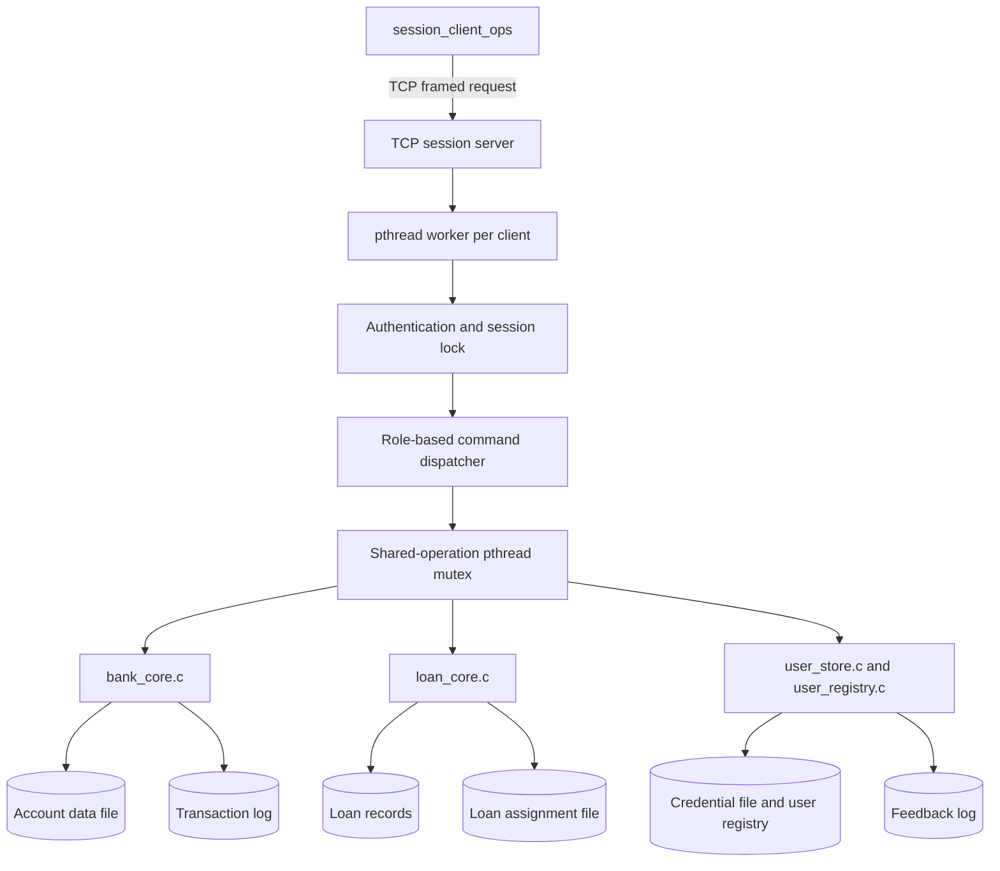
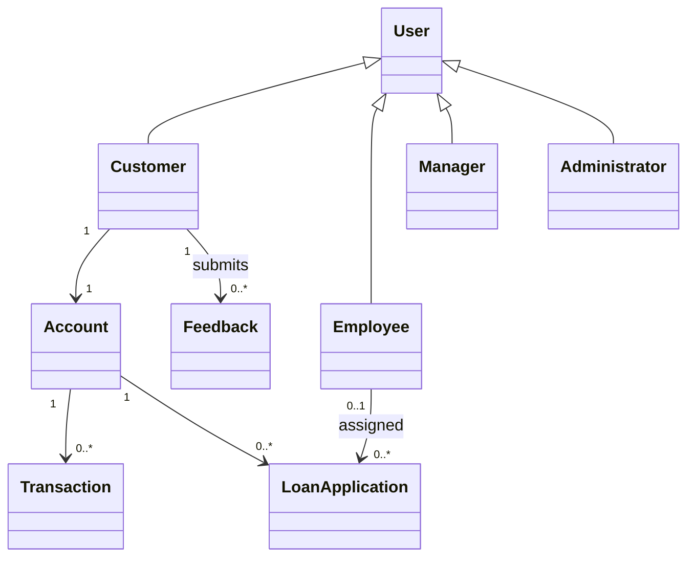

# Banking Management System — Architecture Blueprint

CS-513 System Software Mini Project — IIIT Bangalore

## Component architecture

## Conceptual domain model

The implementation is written in C and uses modules and records rather than object-oriented classes; the domain model is conceptual.

## Main responsibilities

- `session_server.c`: TCP listener, authentication, session limits, command routing and role checks.
- `session_client_ops.c`: interactive command client.
- `bank_core.c`: account file operations, balance changes, transfers, account status, account lookup, transaction history and passbook responses.
- `loan_core.c`: loan application, status, approval and rejection.
- `user_store.c`: credential updates and customer feedback storage.
- `user_registry.c`: persistent user names, account IDs, roles and session lock offsets.

## Synchronization/system calls

- TCP sockets carry length-prefixed requests and responses.
- A pthread worker serves each client connection.
- A global pthread mutex serializes shared-state command processing; state changes are not all executed in parallel.
- File locks coordinate account, loan and credential access; the threaded server uses Linux open-file-description locks for per-user sessions.
- A System V semaphore coordinates shared transaction-log access.
- POSIX/Linux calls include `open`, `pread`, `pwrite`, `write`, `fcntl`, `fsync`, `close`, `socket`, `bind`, `listen`, `accept`, `pthread_create` and semaphore operations.

## Transfer sequence and limitation

A transfer validates sender and recipient, locks both records in a consistent order, calculates both new balances, writes both balance fields and synchronizes the account file, then appends paired `TRANSFER_OUT` and `TRANSFER_IN` records. Ordinary write failures trigger best-effort rollback.

This is not a complete write-ahead journal. A process or machine crash between durable updates can leave account data and the transaction log inconsistent. Full crash-atomic ACID behavior is intentionally not claimed.
